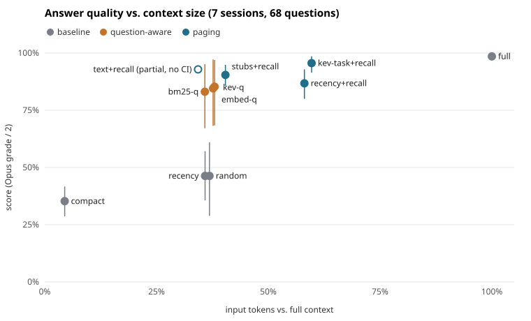

# context-pager

**When a long coding-assistant session fills up with stale tool output, what can you evict and still answer later
questions correctly?** A controlled study on real Claude Code sessions.

> **Short answer:** summaries lose the specifics (35% of questions answered vs. 98.5% with full context). Evicting
> history to one-line stubs and letting the model **page items back in by id** keeps ~90% of answers on ~40% of the
> tokens. Once paging exists, the choice of relevance scorer matters little, and BM25 is as good as a decision model.



Error bars are 95% cluster-bootstrap CIs over sessions. The hollow `text+recall` point is **incomplete** (3 of 7
sessions, no CI); see [Status](#status).

## Results

| condition | what it does | score % [95% CI] | input tokens vs full |
|---|---|---|---|
| `full` | whole history | 98.5 [96.8, 100] | 100% |
| `compact` | LLM summary, up to ~2,000 words | 35.3 [28.7, 41.7] | 4.5% |
| `recency` | keep the newest items | 46.3 [35.6, 57.1] | 35.9% |
| `random` | keep random items | 46.3 [28.9, 61.0] | 36.8% |
| `bm25-q` | keep items matching the question (an upper bound: sees the question) | 83.1 [67.1, 95.2] | 35.8% |
| `kev-q` | same, scored by Kev-0.8B (open Jev clone) | 85.3 [68.4, 97.0] | 38.0% |
| `recency+recall` | recency, plus the model may page items back in | 86.8 [80.0, 92.9] | 58.1% |
| `stubs+recall` | keep only user messages, stub everything else, paging | 90.4 [85.7, 94.9] | 40.4% |
| `kev-task+recall` | blind Kev scoring, plus paging | 95.6 [91.4, 98.6] | 59.7% |
| `text+recall` | keep the conversation, stub all tool calls and output, paging | 92.9 (3 sessions, no CI) | 34.3% |

7 sessions, 68 questions, 708 graded answers. Two judges (Opus, Sonnet) agree on 99.2% of grades (Cohen's κ = 0.978).
Full tables, paired differences and retrieval metrics are in [results.md](results.md). The interpretation and its
limits are in [REPORT.md](REPORT.md).

## What the study found

1. Summaries drop file names, byte counts, versions and exact errors, which are what people come back for.
2. Paging is the main lever. Pruning without recall does no better than random.
3. When the question is known, BM25, embeddings and a decision model land within noise of each other.
4. Predicting future questions from the current task does not work: blind scorers are near chance.
5. Keeping the conversation and stubbing tool output looks like the best trade-off, **provisionally**.
6. Deterministic cleaning (strip HTML, deduplicate) shrinks Claude Code transcripts by only 0.4 to 7.5%.

## Status

This is a first study, not a finished benchmark. Known limits, in order of importance:

- **One user, 7 sessions, 68 point-lookup questions.** Questions needing several evidence items are not measured.
- **`text+recall` is incomplete**, so finding 5 is provisional.
- **Claude is both answerer and judge.** The two judges agree almost perfectly, but that is not independence.
- **The `kev-task+recall` advantage is unexplained.** Kev evicted the evidence item more often than recency did, so
  the gain is not credited to relevance scoring.
- **~60k-token windows**, not million-token sessions.
- **Token savings are not dollar savings.** Prompt caching was off, and eviction can break cached prefixes.

Next steps: public agent trajectories, synthesis questions, a non-Claude judge, and a caching-aware cost measurement.

## Layout

| path | what |
|---|---|
| `study/transcripts.py` | Claude Code `.jsonl` sessions to context items; stub rendering; deterministic cleaning |
| `study/selectors.py` | scorers (recency, random, BM25, bge-small embeddings, Kev) and the shared budget rule |
| `study/llm.py` | headless `claude -p` with no tools, hooks or CLAUDE.md |
| `study/run.py` | the experiment; every stage is cached in `runs/<session-id>/`, so it resumes after interruption |
| `study/analyze.py` | statistics into `results.md` and `results.json`; makes no model calls |
| `study/plot.py` | `results.json` to `docs/score-vs-tokens.svg`; standard library only |
| `tests/test_core.py` | budget filling, BM25, AUROC, cleaning and stub rendering |
| `docs/` | [ideas](docs/IDEAS.md), [Jev research notes](docs/NOTES-jev.md), [practical gotchas](docs/NOTES-practical.md) |
| `pilot/` | archived first pilot (see its README) |

## Data

The study's questions, answers, grades, scores and summaries are **not** published. They were derived from private
Claude Code sessions and quote private project content. What is public: all code, the methodology, the run
configuration (`runs/config.json`) and the aggregate results (`results.md`, `results.json`).

Anyone can regenerate the raw data from their own sessions with `uv run python -m study.run`, which reads
`~/.claude/projects` by default. `study.analyze` needs those regenerated `runs/` directories. A fully public version
built on open agent trajectories is planned.

## Quickstart

```bash
uv sync
uv run pytest -q                    # unit tests, no model calls, no downloads
uv run python -m study.plot         # regenerate the chart from results.json
```

## Reproduce the study

You need the `claude` CLI logged in (it writes the questions, answers them and judges them), about 3 GB of disk for
model weights, and your own Claude Code sessions. Kev-0.8B runs on any Apple Silicon Mac; Kev-4B needs about 32 GB of
RAM. This takes hours and spends model usage.

```bash
uv sync --extra embed
git clone https://github.com/jaredpalmer/kev.git            # Apache-2.0, used only as a local scoring server
(cd kev && uv sync --extra serve && \
  uv run --extra serve python -m kev.serve --run jaredpalmer/kev-0.8b --port 8009) &
uv run python -u -m study.run                                # resumable
uv run python -m study.analyze
```

## Cite

See [CITATION.cff](CITATION.cff), or use GitHub's "Cite this repository".

## License

[MIT](LICENSE). Kev (Apache-2.0) is not vendored; it is cloned separately.
